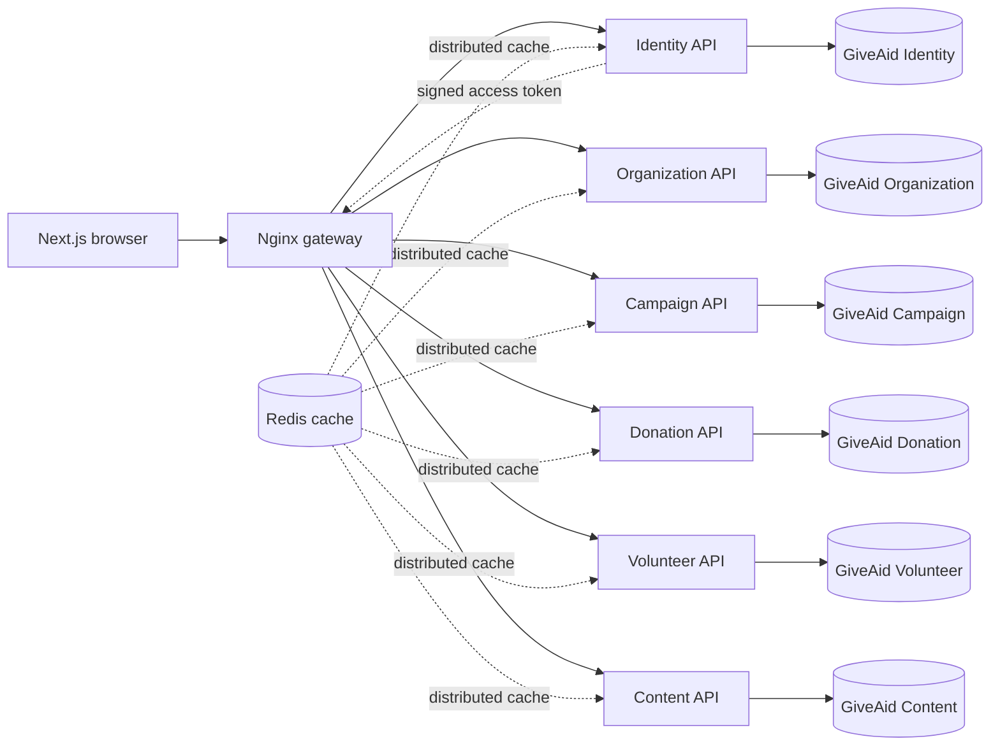

# Give-AID

Nền tảng web quản lý tổ chức từ thiện, chiến dịch, quyên góp mô phỏng và hoạt động tình nguyện. Repository triển khai theo SRS Give-AID 2.0. Tính năng đầu tiên đã có: tài khoản USER/ADMIN và đăng ký tổ chức kèm hồ sơ pháp lý để Admin xét duyệt.

Hướng dẫn tính năng và API hiện tại: [Tài khoản và xét duyệt tổ chức](docs/ONBOARDING.md). File Word hướng dẫn nhóm trong docs là ảnh chụp bộ khung ban đầu; tài liệu Markdown này mô tả tính năng mới nhất.

Email tiếp nhận hồ sơ và kết quả xét duyệt đã tích hợp qua EmailJS tại OrganizationService, có SQL outbox, retry và theo dõi trong chi tiết hồ sơ admin. Xem [cấu hình và vận hành email](docs/ORGANIZATION-EMAIL.md).

Đã có workspace riêng cho OWNER/thành viên và danh bạ giám sát của admin, gồm hồ sơ vận hành, nhân sự nhiều vai trò, lời mời trong ứng dụng, khóa quyền và xét duyệt thay đổi pháp lý. Xem [API, phân quyền và chia việc](docs/ORGANIZATION-WORKSPACE.md).

## Công nghệ

- Frontend: Next.js, React và TypeScript.
- Backend: ASP.NET Core Web API trên .NET 10.
- Dữ liệu: SQL Server; mỗi service có database riêng, dùng chung một SQL Server instance trong môi trường dev.
- Cache: Redis qua `IDistributedCache`; cache chỉ dùng cho dữ liệu đọc phù hợp, không dùng làm nguồn sự thật cho giao dịch hoặc quyền truy cập.
- API Gateway: Nginx; trình duyệt chỉ truy cập gateway.
- Local orchestration: Docker Compose.

## Chạy local

Cần .NET SDK 10 (global.json chỉ định 10.0.103), Docker Desktop ở chế độ Linux containers và khoảng 6 GB RAM cho Docker. Node.js 22 chỉ cần nếu chạy frontend ngoài Docker.

```powershell
powershell -NoProfile -File scripts/start-dev.ps1
```

Mở http://localhost:8080. Lệnh tạo `.env` và cặp khóa RSA dùng riêng cho môi trường dev khi chưa có, chuẩn bị build context trong `%TEMP%` để tránh vấn đề Docker/OneDrive, build và chạy stack. Có thể chạy trực tiếp ở thư mục không dùng OneDrive:

```powershell
powershell -NoProfile -File scripts/init-dev.ps1
docker compose up --build
```

Một số lệnh quản lý:

```powershell
docker compose ps
docker compose logs -f gateway identity organization
docker compose down
```

Không dùng `docker compose down -v` nếu muốn giữ dữ liệu volume. `.env` chứa secret local và không được commit.

Lần chạy đầu sinh ADMIN_EMAIL và ADMIN_PASSWORD trong .env; tài khoản Admin được tạo bởi migration job, không có mật khẩu dùng chung trong source. Đăng nhập tại /login và đổi mật khẩu ở /account. Khởi động lại không đặt lại mật khẩu đã đổi.

Identity và Organization có migration riêng. Compose cấp login SQL riêng cho mỗi API, chỉ có quyền dữ liệu trong database của service; container migration dùng tài khoản bootstrap để tạo schema. Hồ sơ pháp lý và số định danh được mã hóa bằng Data Protection, keyring nằm trong volume organization-keys. Sao lưu cả database và keyring; mất keyring sẽ không đọc lại được hồ sơ.

## Cấu trúc và quyền sở hữu dữ liệu

```text
backend/
  Shared/                 Chỉ plumbing kỹ thuật dùng chung
  IdentityService/        Tài khoản, xác thực và quyền nền tảng
  OrganizationService/    Hồ sơ NGO và thành viên tổ chức
  CampaignService/        Campaign, Beneficiary và quy trình duyệt
  DonationService/        Donation demo, payment adapter và tài chính
  VolunteerService/       Đăng ký, lịch, nhiệm vụ và điểm danh
  ContentService/         Nội dung công khai và truy vấn hỗ trợ (host nền)
frontend/src/app/         Next.js app router
infra/gateway.conf        Định tuyến API và health endpoints
compose.yaml              Hạ tầng dev và các service
```

Mỗi service sở hữu model, migration và database riêng. Service khác không đọc database đó và không tạo khóa ngoại xuyên service. Một SQL Server instance trong dev giúp tiết kiệm tài nguyên. Identity và Organization đã dùng login riêng có quyền đọc/ghi dữ liệu; các service chưa triển khai nghiệp vụ vẫn là host rỗng.

## Luồng giao tiếp



Gateway chỉ định tuyến, không chứa quy tắc nghiệp vụ. Backend xác thực JWT RS256 ở từng API; Identity giữ khóa riêng để ký, các API còn lại chỉ nhận khóa công khai để xác minh. Không gọi Identity trong mỗi request để kiểm tra trạng thái token. Dữ liệu công khai có thể dùng cache-aside với TTL và invalidation rõ ràng. Không cache trạng thái quyền nhạy cảm, khoản quyên góp chưa chốt hoặc dữ liệu nhận dạng Beneficiary. Các tương tác xuyên miền nên bắt đầu bằng API contract có timeout và xử lý lỗi; nếu cần đồng bộ trạng thái giữa nhiều miền, dùng sự kiện/outbox thay cho ghi chéo database. Chưa thêm message broker khi chưa có luồng bất đồng bộ cụ thể.

## API prefixes

| Prefix | Service |
|---|---|
| `/api/auth`, `/api/users` | Identity |
| `/api/organizations` | Organization |
| `/api/campaigns`, `/api/beneficiaries` | Campaign |
| `/api/donations` | Donation |
| `/api/volunteers`, `/api/schedules`, `/api/tasks` | Volunteer |
| `/api/content`, `/api/queries`, `/api/invitations` | Content |
| `/health/{service}` | Liveness của từng API |

Các prefix là điểm xuất phát; cập nhật gateway khi nhóm chốt API contract. Gateway trả 404 cho prefix `/api` chưa khai báo.

## Quy ước phát triển

- Giữ controller/API boundary, application service, repository và persistence trong service sở hữu nghiệp vụ đó.
- `Shared` chỉ chứa cross-cutting plumbing và contract kỹ thuật ổn định; không đưa entity hay quy tắc nghiệp vụ vào đây.
- Thêm migration trong đúng service và không truy cập database service khác.
- Không lưu số thẻ, CVV/CVC hoặc PIN. Payment chỉ mô phỏng và cần thể hiện rõ trên giao diện.
- Cấu hình connection string, SMTP và payment adapter qua environment; khóa JWT dev được giữ trong `.secrets/` và không ghi vào source.
- Cập nhật SRS khi thay đổi quyết định công nghệ hoặc phạm vi.

## Kiểm tra build

```powershell
dotnet build Give-AID.slnx -m:1
cd frontend
npm ci
npm run build
```
